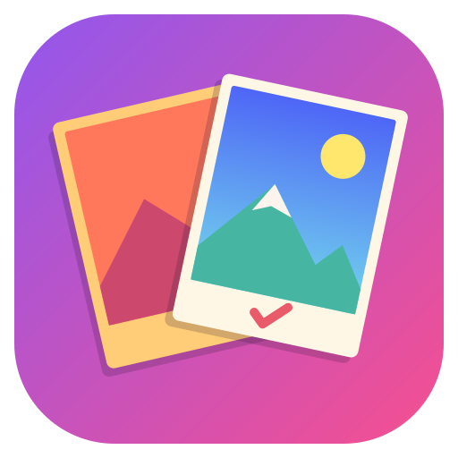
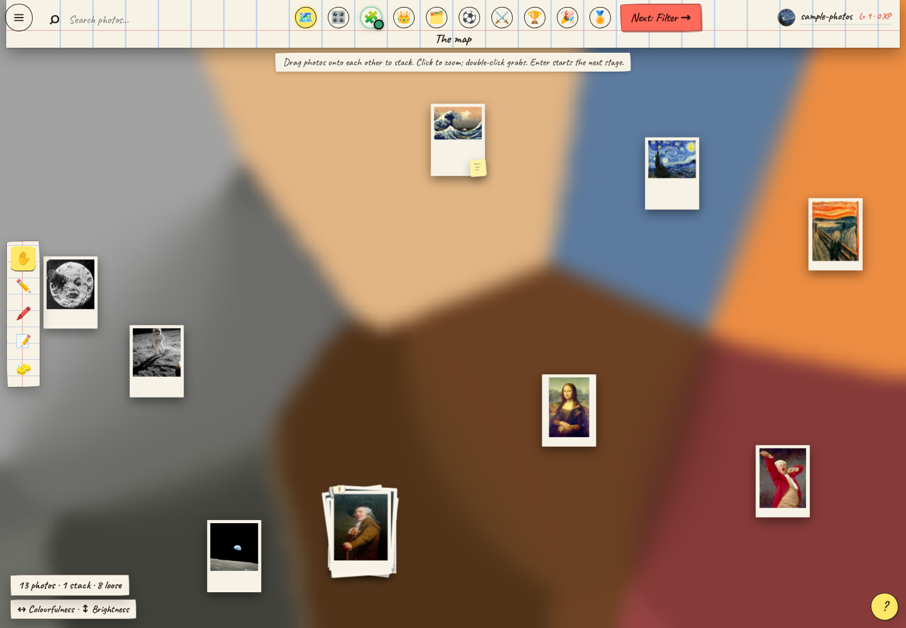
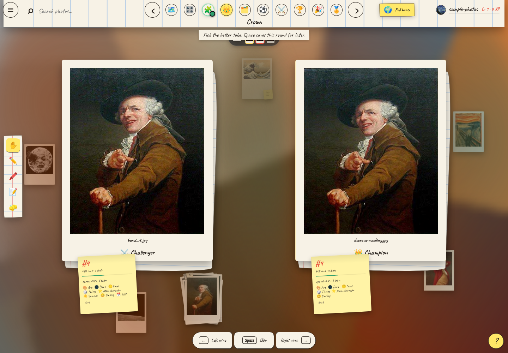
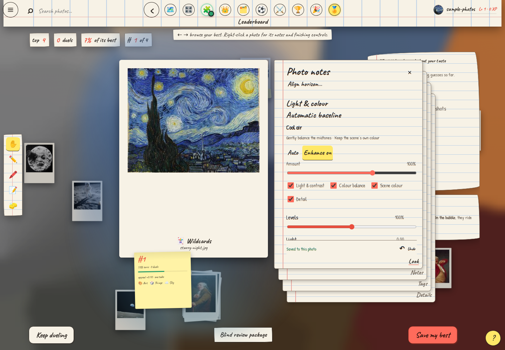
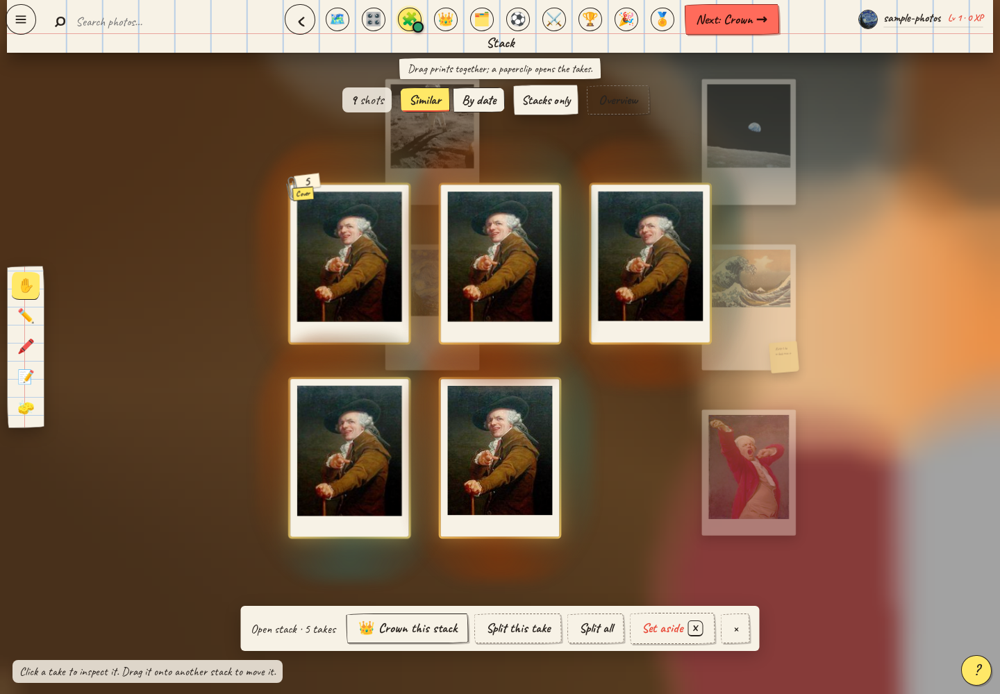
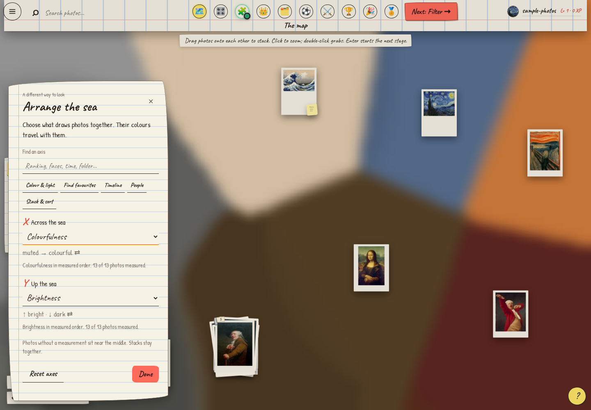

<div align="center">



# MatchER

**Turn a folder of photos into a game. Find the keepers.**

A local photo organizer that learns your taste through play.<br>
Filter the misses. Stack the near-duplicates. Crown your favourites.

[**Download for Windows or Linux**](https://github.com/nikhilavibeauterai/MatchER/releases) · [Getting started](docs/install.md) · [Full guide](docs/guide.md) · [Report a bug](https://github.com/nikhilavibeauterai/MatchER/issues/new/choose)

**Local AI · No account · No photo uploads · Originals stay untouched**

</div>



You know the feeling: a folder full of almost-the-same shot, and no idea which one to keep.
MatchER makes choosing enjoyable. It recognizes subjects, gathers bursts into stacks and turns your
favourites into a tournament. You make quick, small choices; it learns what you like and builds your shortlist.

- **Sort a trip, a pet obsession or your entire camera roll.** Gallery mode groups landscapes, people,
  animals, food and more into cups of their own.
- **Find your next profile photo.** Profile mode recognizes you and helps compare expressions, light and framing.
- **Stack without leaving the sea.** Arrange the same prints by similarity or date, drag them together and
  pull a paperclip to spread the takes in place. Loose photos belong here too. Zoom, notes and Undo follow along.
- **Make the collection yours.** Drag photos together, edit tags, draw on prints and leave sticky notes.
  Pull out a focused photo's paper stack and click its handwritten corners to bring a sheet forward.
  Right-click a photo to open its notes; right-click it again to tuck them away.
  Notes saves your title and story as you write; Tags lets you search,
  add and correct what it recognizes; Look has exact crop and aspect-ratio controls, horizon straightening,
  three colour wheels and painted local adjustments, with a hold-to-compare original;
  Details keeps the file information, collection and analysis together. The sheet stays readable as you zoom;
  drag its paper to pan the view, or scroll inside it to read more. Undo is there when you change your mind.
- **Find a photo with words.** Search for “red jacket”, a tag, a filename or your own writing from any stage.
  Visual search runs locally using the understanding already saved during analysis.
- **Find another way to see the collection.** Arrange the sea by machine ranking, your own preferences, hue,
  light, dates, expressions, camera, file details or groups. Search the axes or start with a preset.
- **Give every photo a thoughtful starting edit.** A saved per-photo tone curve corrects exposure, restores depth
  and balances colour while preserving night scenes and monochrome. Adjust its amount and individual parts in the
  Look sheet, then add your own grading, masks, crop and alignment. Auto-align checks structural edges and horizons; manual angles
  win. Hold for original; Undo brings every change back.
- **Finish with something useful.** Crown the best take in each stack, play groups and knockouts, then export
  your winners with their crop, alignment, enhancement, colour grading and masks. Your original files are never overwritten.

## Start playing

| Your computer | Download from [Releases](https://github.com/nikhilavibeauterai/MatchER/releases) | Start |
|---|---|---|
| Windows 10 / 11, x64 | `MatchER-…-win-x64.exe` | Install for your account; open MatchER from Start. |
| Ubuntu / Debian, x64 | `MatchER-…-linux-x64.deb` | Open in your software installer; launch from Applications. |
| Other Linux desktops, x64 | `MatchER-…-linux-x64.AppImage` | Allow execution in file properties, then double-click. |

Desktop releases include Python and the browser engine. **You don't need a terminal or a Python installation.**
This is an early preview: installers are unsigned, and ARM/macOS builds are not available yet. If release assets
are still building, use the source launchers below. Screenshots and this guide describe the current source;
the published 0.1 preview predates the latest sea and editing improvements. [Installation details and troubleshooting →](docs/install.md)

On first launch, choose **Try it with sample photos** for the bundled public-domain paintings, NASA images and
classic meme faces. Or choose your own folder. First analysis downloads about **256 MB of verified models**;
afterward, the game runs offline. Your photos, face data and choices stay on your computer.

**Already have Python 3.13?** Clone or download the repository, then open `matcher.cmd` on Windows or run
`./matcher.sh` on Linux. It installs checked dependencies and opens MatchER in your browser.

```sh
git clone https://github.com/nikhilavibeauterai/MatchER.git
cd MatchER
./matcher.sh
```

On Windows, open `matcher.cmd` in that folder instead of the last command.

## From camera roll to champions

**Filter → Stacks → Crown → Groups → Group stage → Knockouts → Finals → Reveal**

Keep what catches your eye, set aside what doesn't, and teach the filter with Love and Hate. Crown one take
from each stack. Give the contenders a home, play their groups and follow the bracket to your winners.
Scroll or pinch to zoom in on a photo throughout the journey: Quick sort, Crown, Group stage, Knockouts,
Finals, Leaderboard and Reveal share the sea’s camera. Drag a close-up to pan; double-click to reset.
Large prints load their original image, and a new comparison resets the view. Zooming and panning never vote
or file a photo. At normal size, drag the dealt photo into a group as usual.
There are no required voting marathons: move on when you're ready, skip a hard choice, and return later.
Every folder has its own saved progress, trophies and leaderboard.
The save picker notices when you plug in or unplug a drive. Disconnected saves stay on the list and become
playable again when their folder returns; Browse here also updates its mounted-drive shortcuts automatically.

Stacks shows loose photos alongside piles of takes, so you can drag either onto another to combine them.
Switch on **Stacks only** when you want to concentrate on existing piles.

| Choose the strongest take | Finish your favourites |
|---|---|
|  |  |
| Compare expressions, framing and tiny details. | Start with Auto, then make the edit yours. |

| Organize piles and loose photos | Explore the collection |
|---|---|
|  |  |
| Drag photos together; spread their takes in place. | Change the axes without changing your photos or votes. |

All screenshots use the [bundled public-domain demo](matcher/demo/manifest.json).

## Your photos stay yours

Analysis runs locally on your CPU. No cloud model, subscription or account is needed. MatchER reads your folder,
keeps its own previews and database, and saves every choice. It sets photos aside inside the game; it never
silently deletes or overwrites an original. Notes and drawings stay in the save and aren't baked into exports.

JPEG, PNG, HEIC/HEIF, WebP, TIFF and camera RAW formats are supported. A first scan can take a while;
reopening an analyzed library is quick. [Storage locations and backups →](docs/install.md#where-your-saves-live)

During analysis, scroll over the sea to zoom, drag open water to pan, and double-click open water to see everything
again. Refreshing restores the photos and discoveries already shown. Restarting MatchER resumes saved analysis,
including its completed photo count, without reading those photos again.

The open sea undulates in drifting foam-like pockets, with small folds along their edges and neighbouring currents
moving in different directions. Palettes sampled from nearby photos extend into the whole sea, blending where
neighbouring colours overlap. Deep purples stay purple, and distant photos in the same group do not wash them out.
There is no separate background between patches. The same currents carry the colour and the prints.
Photos keep their underlying places, the water pauses when you reach for a print, and close-ups become steady for
reading and editing.
Reduced-motion preferences still the waves; the developer panel adjusts their height, speed, spacing and ripples.

The small axis key below the photo count opens **Arrange the sea**. Search more than 40 measurements or choose
Colour & light, Find favourites, Timeline, People, or Stack & sort. Machine ranking, aesthetic score and your
learned ranking are separate choices; uncertainty shows which photos need more comparisons. Capture dates,
expressions, subject position, file dimensions, camera, folder and group are available too. Either axis can run
in reverse. Choices stay with the save; Reset axes restores the colour-and-light layout. A date axis offers a
jump to any day in the library. Find the same controls under **Menu → Picture & sound → Sea axes**.
Brightness runs from dark at the bottom to bright at the top. Rearranging lets photos cross to their new homes
before they settle. In debug mode, **Macro → Top/Right/Bottom/Left margin** tunes each edge independently;
values are fractions of the viewport (0.04 = 4%); the standard top margin is **0.2**. Each edge can be tuned separately. The
panel remembers these values in your browser and includes them in Export.

## Help build it

MatchER is young, and real Windows/Linux feedback will make it better. Try the sample, file a clear bug report,
or improve a rough edge. The app is Python/Flask with plain JavaScript and an Electron desktop window.
Large group lists render nearby rows while keeping every photo reachable; small sea prints and bulk selections
stay on the atlas. See the [performance measurements](docs/performance.json) and [contributor benchmark commands](CONTRIBUTING.md).

[Contributing](CONTRIBUTING.md) · [Build desktop packages](docs/building.md) · [Browser tests](tests/ui/README.md) · [Security](SECURITY.md) · [Third-party credits](THIRD_PARTY_NOTICES.md)

MatchER is free software under [GNU GPL version 3](LICENSE). You can use, study, modify and share it;
distributed derivatives must preserve the license and provide their corresponding source.
[Source for desktop releases →](SOURCE.md)
