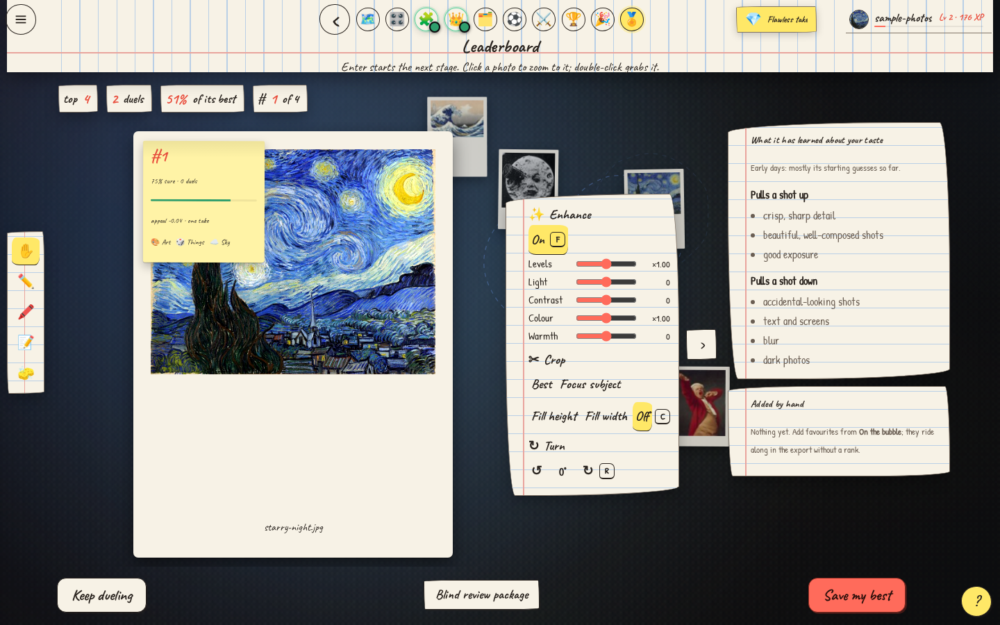

# MatchER

**Turn a folder of photos into a game. Find the keepers.**

A local photo organizer that learns your taste through play. 
Filter the misses. Stack the near-duplicates. Crown your favourites.

[**Download for Windows or Linux**](https://github.com/nikhilavibeauterai/MatchER/releases) · [Getting started](docs/install.md) · [Full guide](docs/guide.md) · [Report a bug](https://github.com/nikhilavibeauterai/MatchER/issues/new/choose)

**Local AI · No account · No photo uploads · Originals stay untouched**

You know the feeling: a folder full of almost-the-same shot, and no idea which one to keep.
MatchER makes choosing enjoyable. It recognizes subjects, gathers bursts into stacks and turns your
favourites into a tournament. You make quick, small choices; it learns what you like and builds your shortlist.

- **Sort a trip, a pet obsession or your entire camera roll.** Gallery mode groups landscapes, people,
  animals, food and more into cups of their own.
- **Find your next profile photo.** Profile mode recognizes you and helps compare expressions, light and framing.
- **Make the collection yours.** Drag photos together, edit tags, draw on prints and leave sticky notes.
  Undo is there when you change your mind.
- **Finish with something useful.** Crown the best take in each stack, play groups and knockouts, then export
  your winners with optional crop, rotation and enhancement. Your original files are never overwritten.

## Start playing

| Your computer | Download from [Releases](https://github.com/nikhilavibeauterai/MatchER/releases) | Start |
|---|---|---|
| Windows 10 / 11, x64 | `MatchER-…-win-x64.exe` | Install for your account; open MatchER from Start. |
| Ubuntu / Debian, x64 | `MatchER-…-linux-x64.deb` | Open in your software installer; launch from Applications. |
| Other Linux desktops, x64 | `MatchER-…-linux-x64.AppImage` | Allow execution in file properties, then double-click. |

Desktop releases include Python and the browser engine. **You don't need a terminal or a Python installation.**
This is an early preview: installers are unsigned, and ARM/macOS builds are not available yet. If release assets
are still building, use the source launchers below. [Installation details and troubleshooting →](docs/install.md)

On first launch, choose **Try it with sample photos** for the bundled public-domain paintings, NASA images and
classic meme faces. Or choose your own folder. First analysis downloads about **256 MB of verified models**;
afterward, the game runs offline. Your photos, face data and choices stay on your computer.

**Already have Python 3.13?** Clone or download the repository, then open `matcher.cmd` on Windows or run
`./matcher.sh` on Linux. It installs checked dependencies and opens MatchER in your browser.

## From camera roll to champions

**Filter → Stacks → Crown → Groups → Group stage → Knockouts → Finals → Reveal**

Keep what catches your eye, set aside what doesn't, and teach the filter with Love and Hate. Crown one take
from each stack. Give the contenders a home, play their groups and follow the bracket to your winners.
There are no required voting marathons: move on when you're ready, skip a hard choice, and return later.
Every folder has its own saved progress, trophies and leaderboard.

| A map you can touch | A shortlist you can finish |
|---|---|
|  |  |
| Pan, zoom, stack and organize your photo table. | Adjust your winners and save your best. |

All screenshots use the [bundled public-domain demo](matcher/demo/manifest.json).

## Your photos stay yours

Analysis runs locally on your CPU. No cloud model, subscription or account is needed. MatchER reads your folder,
keeps its own previews and database, and saves every choice. It sets photos aside inside the game; it never
silently deletes or overwrites an original. Notes and drawings stay in the save and aren't baked into exports.

JPEG, PNG, HEIC/HEIF, WebP, TIFF and camera RAW formats are supported. A first scan can take a while;
reopening an analyzed library is quick. [Storage locations and backups →](docs/install.md#where-your-saves-live)

## Help build it

MatchER is young, and real Windows/Linux feedback will make it better. Try the sample, file a clear bug report,
or improve a rough edge. The app is Python/Flask with plain JavaScript and an Electron desktop window.

[Contributing](CONTRIBUTING.md) · [Build desktop packages](docs/building.md) · [Browser tests](tests/ui/README.md) · [Security](SECURITY.md) · [Third-party credits](THIRD_PARTY_NOTICES.md)

MatchER is free software under [GNU GPL version 3](LICENSE). You can use, study, modify and share it;
distributed derivatives must preserve the license and provide their corresponding source.
[Source for desktop releases →](SOURCE.md)
